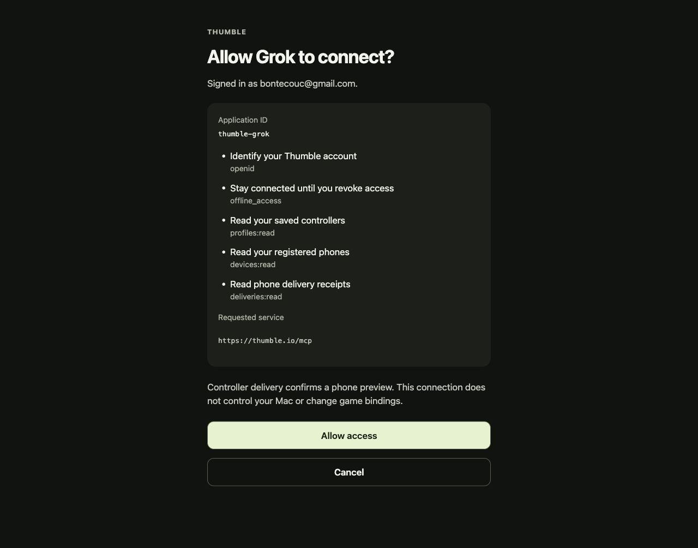
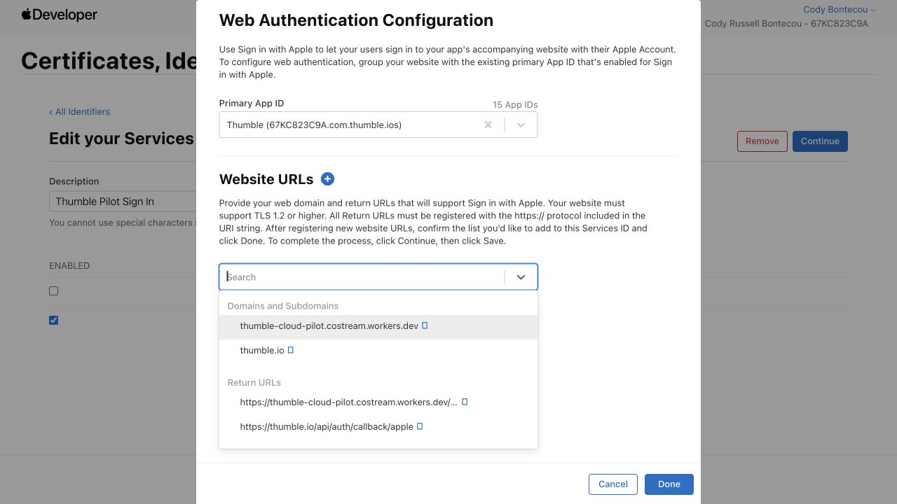
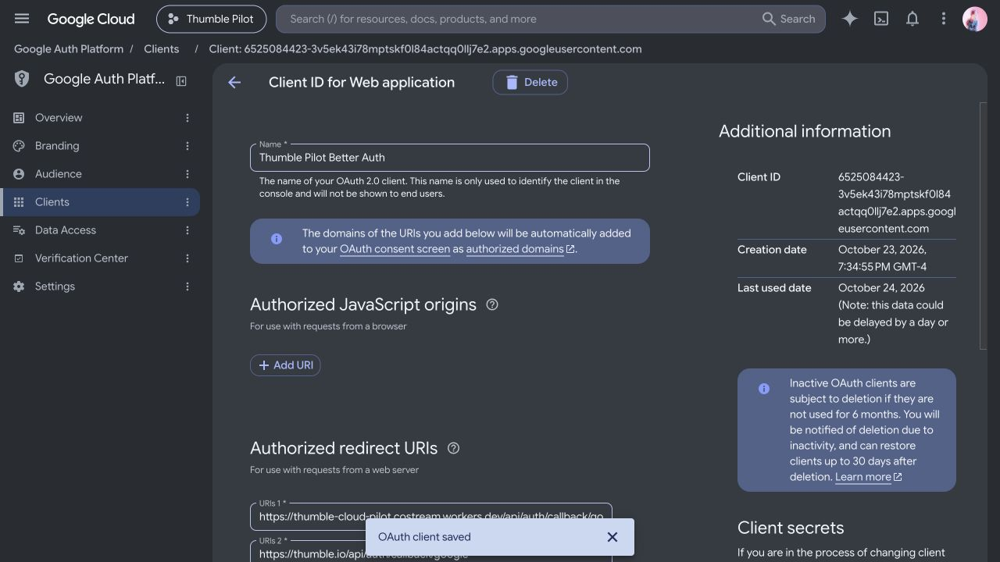

# Authentication domain migration — October 24, 2026

Authentication is deployed at `https://thumble.io` on the existing `thumble-cloud-pilot` Worker and D1 database. Final version: `528a3572-42d1-4fa7-9ba4-c9b032a3b019`. The former live version was `62db3509-24a4-43f1-83c0-9f14a25198fe`, from commit `98818e56a47b5c045a78a2ab9bcd8d2d04b633cc`.

The release was built from that commit plus only `auth.js`, `identity.js`, `auth-pages.js`, `worker.js`, and the authentication routes/variables in `wrangler.pilot.jsonc`. Unrelated local feature work was excluded. Deployment used `--keep-vars`; no secret, database, provider client identifier, callback registration, or grant was replaced. No D1 migration was required.

## Compatibility

- New MCP discovery advertises `https://thumble.io/api/auth`. Google and Apple callbacks on this origin are registered alongside their original workers.dev callbacks.
- Requests to the exact configured `LEGACY_AUTH_URL` retain their original issuer, auth URLs, cookies and callback behavior. Token endpoints are served directly, without redirecting refresh requests. New and legacy auth instances share users, encrypted signing keys, sessions, clients, consent and refresh grants in the same D1 database.
- Resource authentication verifies signatures, expiry, scopes and audience, and accepts only the configured issuers. Both original and canonical MCP audiences remain accepted.
- `ACCOUNT_ID_ISSUER` stays `https://thumble-cloud-pilot.costream.workers.dev/api/auth`. Both issuers map the same user to the original account ID. Account management, deletion assertions and tombstones use that same namespace.
- Existing phones retain their persisted service, account ID, device credential, OAuth endpoints and refresh token. Future phone builds default to `https://thumble.io`; future receiver builds use it for new pairing authorization. These source changes do not rebuild or install apps.
- The canonical OpenAI manifest and local `thumble-controller-openai-0.2.1.zip` use the branded auth endpoints. Submitted listings and historical archives were not replaced. Clients with cached discovery may keep displaying the old auth domain until they refresh discovery; they remain supported.

Keep the old origin operational while clients depend on it. The account namespace must remain stable for the lifetime of the existing data; changing it requires a separate data mapping migration.

## Verification

- 219 repository tests passed, including actual pre-migration native/ChatGPT token issuance followed by legacy refresh, in-flight consent/code exchange, canonical authorization and stable account IDs. Both issuers remain subject to deletion invalidation.
- The local Worker/D1 integration test changes the origin after registering a phone, publishing pairing state and saving a controller. The cached phone refreshes at its original endpoint; a new canonical AI token reads the saved controller and delivers it to the original device credential. Delivery receipts and deletion invalidation pass after migration.
- Mobile lint/typecheck passed. Native QR and hosted pairing lifecycle regression tests passed.
- Live Google sign-in returned successfully through `https://thumble.io/api/auth/callback/google`. The live Grok consent page loaded at `https://thumble.io/consent`; no new Grok grant was approved for this check.
- The existing connected Thumble Pilot Cloud plugin successfully listed both registered phones and all four saved profiles after deployment, using its existing authorization.
- Google and Apple settings were reopened after saving and showed both callbacks. The live endpoint results are in [live-verification.json](live-verification.json). Public JWKS are compared to [the pre-deployment keys](before-public-keys.json).

The integration test simulates social identity and phone rendering. No physical phone was reauthenticated or used for a new live delivery during this migration. Apple callback registration and generated redirect URLs were verified; a fresh live Apple sign-in was not completed.

