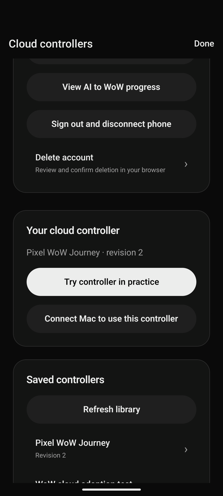

# Latest cloud deployment — October 24, 2026

Deployed Worker version `3a94291b-b2be-4a04-942e-52dab5e43375` to the existing `thumble-cloud-pilot` service with `--keep-vars`. The prior deployment was `51331897-27cd-4e3a-9ee0-6a6d7f7dd91f`. The snapshot starts from commit `2d59f62` and includes the local cloud auth/Glama monitoring changes present at snapshot time. Its source checksums are in `source-sha256.json`; `deployment.txt` records the successful publish.

The release includes primary MCP OAuth scope metadata, merging persisted OAuth resource scopes, disabled AI controller-generation tools, and callback/account/scope-restricted Glama monitoring. Both authentication origins and the original account-ID namespace are preserved. The same D1 database and provider/signing secrets remain in use. No database migration or credential reset was performed.

## Results

- All 221 repository tests passed.
- The exact release snapshot passed bundled Worker/D1 integration: native/public AI consent and PKCE, upgrading existing grants for pairing scopes, old phone refresh tokens, stable account IDs, saved controllers, existing-device delivery/receipts and deletion invalidation.
- Both live origins passed OAuth/OIDC discovery, native configuration, protected-resource permissions and MCP authentication checks. Public JWKS match their pre-deployment values exactly. See `public-verification.json` and `before-jwks.json`.
- Both previously connected MCP plugins listed the original Android and iPhone registrations without reconnecting. The existing controller plugin also listed all four saved profiles. Before/after evidence is in `mcp-continuity.json`.
- On the physical Pixel 7, the original `com.thumble.android.pilotqa` session still uses `https://thumble-cloud-pilot.costream.workers.dev` and device ID `2661910d-39d5-471c-9991-a658ad3d156d`. After deployment, tapping **Refresh library** changed its initially empty in-memory library into saved profile rows including **Pixel WoW Journey, revision 2**, without sign-in, reinstall or token extraction. The device's server last-seen time advanced to `2026-10-24T20:43:55.280Z` under the same registration.
- The polished `.argent/e2e/legacy-cloud-phone-refresh.yaml` replay passed all six steps without warnings, failures, errors or manual rescue. It is a fragment requiring that pilot build's existing account, seeded controller and portrait Cloud controllers screen. It refreshes the library only; it does not send a controller or game input.

The regular `com.thumble.android` build has no saved cloud account; it was not used to claim session continuity. The original saved session belongs to the separate pilot QA build. An exploratory production navigation recording was incomplete: landscape menu input did not navigate, and the role-only recorded tap was rejected as evidence. Its raw take is preserved as `android-navigation-incomplete.yaml`, outside the executable test directory. The pilot app was opened explicitly by package to avoid Android's two-app scheme chooser. The refresh fragment's raw take is in `android-refresh-recorded.yaml`; polish replaced scrolling gestures with semantic scroll-to and retained the positive saved-profile assertion.

The previously registered iPhone was not connected for a new live phone-side check. Its registration remains unchanged, and shared OAuth/session behavior passed the integration tests. No fresh physical-iPhone refresh or delivery is claimed.

