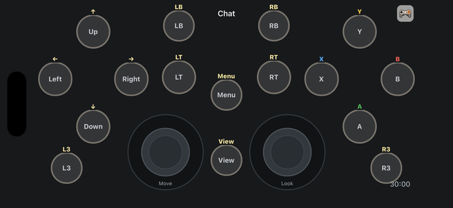
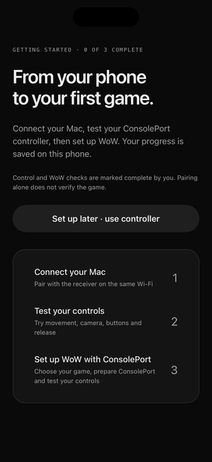

# ConsolePort default and generator flag

Verified October 24, 2026, on the Tapping React Native QA iOS simulator.

The generator defaults off. The mobile build uses `EXPO_PUBLIC_AI_CONTROLLER_GENERATOR_ENABLED`; the cloud Worker and local MCP process each use `AI_CONTROLLER_GENERATOR_ENABLED`. Only the exact string `true` enables generation. The checked-in cloud deployment configurations explicitly set `false`. The cloud change and connected-phone builds were deployed on October 24, 2026; details follow below.

ConsolePort is the initial and disconnected phone profile. Setup has three milestones, and AI routes/actions are hidden or protected. The cloud route offers account management only when generation is disabled; loading an existing account cannot replace the ConsolePort practice layout or start delivery polling. Saved Mac profiles remain selectable. Calibration applies to the built-in ConsolePort profile even after it is selected from the Mac catalog.

Shoulder/trigger and stick-click targets were enlarged. Geometry checks pass on usable landscape canvases of 568×300, 640×320, 740×380, 840×380, and 900×420 logical points. All standard gamepad mappings are retained.

Validation:

- `npm test`: 208 passed, including disabled MCP calls, hidden tool catalogs, REST bypass rejection, and explicit mobile/backend opt-in coverage.
- `npm run check`, mobile lint, and mobile typecheck passed.
- Production iOS JavaScript bundle exported successfully.
- `.argent/e2e/consoleport-default-flag-off.yaml`: uninterrupted replay passed, 8 executed actions/checks, no failures or errors. Requires a fresh installation of the isolated QA app `com.thumble.consoleportflagqa`, created from an existing simulator binary with the current production JavaScript bundle.
- Live screenshots confirm the three-step setup, ConsolePort menu, and landscape controller. This verifies mobile behavior; no new in-game WoW test was performed.

The initial recorder had slow native view-tree reads and captured two coordinate taps. The final replay uses semantic text/id selectors for every tap and accessibility checks after navigation. Replay passed after reinstalling the isolated QA app. The recording is stored locally in `.argent/recordings/screen-recording-87952CD2-B760-40A1-AF11-5CE40995960B-1792862992130.mp4` (ignored by Git).

## Connected-device deployment

- Installed the complete Release build on the connected iPhone 13 Pro Max (`com.thumble.ios`) with Xcode development signing. App data was retained; launch showed the saved pairing milestone and the new three-step ConsolePort setup.
- Built the Android Release APK and signed it with the existing local development key matching the installed Pixel 7 app. The initial project-key install was rejected without changing data; the matching-key update succeeded. Launched `com.thumble.android` and verified the ConsolePort welcome screen.
- Android artifact: `build/Thumble-ConsolePort.apk`, SHA-256 `1dde1f2abdd3f45368ca337906e01ac3cf430be6dc48c762ecb6f6dff658e9fc`.
- iPhone artifact: `build/consoleport-ios-device/Build/Products/Release-iphoneos/Thumble.app`.
- Deployed Worker version `9df7f095-b538-40ee-a76d-019edb0a6fdf` to the existing `thumble-cloud-pilot` service and canonical `thumble.io/mcp` routes, with `AI_CONTROLLER_GENERATOR_ENABLED=false`.
- Cloud release source was isolated under `/private/tmp/thumble-consoleport-release` from base commit `d4044ec` plus the feature-flag edits. Unfinished hosted-pairing code, identity scope changes, the fifth migration, and its cleanup schedule were excluded. Existing variables were preserved with `--keep-vars`.
- The isolated release passed 49 cloud tests, a Worker bundling dry run, the actual Worker/D1 runtime test, and the Better Auth OAuth runtime test. Generator runtime test fixtures explicitly opt in; deployed configuration remains disabled.
- An authenticated call to the deployed generation validator returned `feature_disabled` and the instruction to use ConsolePort. No profile was written by this verification.
- Rebuilt the Mac receiver and selected `consoleport-standard`, saved profile revision 1, activation revision 14, retaining the other saved profiles. Production purchase configuration is embedded.
- The local receiver could not create its virtual HID device with the Developer ID signature/profile. Re-signing the same binary with the existing Apple Development identity and approved Mac development profile restored virtual HID startup; the receiver window shows **Ready · scan to connect**. This local development-signed receiver is running from `build/Thumble Receiver.app`; public/notarized downloads were not replaced. The prior production bundle was backed up at `build/Thumble Receiver.before-consoleport.app`.
- Receiver restart invalidated the old pairing. A fresh pairing code is visible on the Mac; no new gameplay input or WoW acceptance test was performed.
- Stopped the pre-update local MCP processes. A fresh stdio launch advertises only pairing/read-only inspection and rejects generation. Existing Codex connector transports report closed until refreshed/reconnected.

Build/install/deploy logs are saved under `build/consoleport-*`.
