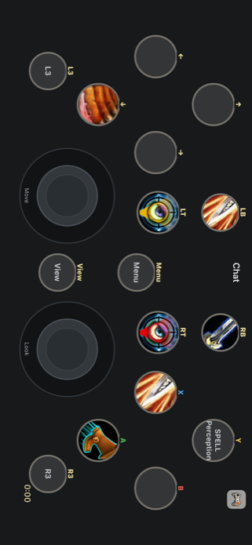

# Character spell artwork and held layers

Verified October 24, 2026. The development-signed Release build of `com.thumble.ios` is installed on the connected iPhone 13 Pro Max. Installation preserved app data. The character layout was delivered and acknowledged as `consoleport-fuskotargar`, profile revision 1, activation 15. The phone was left displaying that layout in offline practice.

## Source and behavior

Computer use inspected the running WoW client: Fuskotargar, level-1 warrior, Azuresong. Through the existing Thumble Bridge UI, Export character was clicked, then `/reload` saved the snapshot. Its ID is `Player-5117-069A313F:1792866083:1:27132335`. No WoW binding changes or plans were applied.

The receiver profile copies exported appearance by gamepad output onto the existing ConsolePort phone layout. Control IDs, positions and mapping configuration are preserved. Spell and item IDs resolve to WoW icon names using public Wowhead metadata. The phone loads the actual icons from the fixed WoW icon CDN. Utility artwork uses the existing licensed ConsolePort PNGs. Every exported layer's artwork is prefetched; missing/loading/failed images retain the action's text and accessibility name. Empty layers clear their icon rather than retaining a base spell.

The new `preserveSourceLayout` option on `mirror_consoleport` requests this appearance-only copy. Existing callers retain the original geometry mirroring behavior. The generator feature flags were not globally enabled.

This character's modified spell slots are mostly empty. LT shows Target Scan Enemy on RB; RT shows Quick menu on A; both show Utility ring on A. Complementary trigger actions follow the export. Base actions include Heroic Strike, Attack, Tough Jerky and Jump. The export contains `SPELL Perception` without a resolved spell ID; its text is retained, with no invented spell icon.

Practice mode entered from the expired-demo screen now retains the received character layout for that session while disconnecting input. Ordinary disconnect behavior is unchanged. App restarts still begin with the built-in offline layout until the character profile is received again.

## Validation

- 217 tests passed, including appearance-only source geometry/mapping preservation and an explicit practice disconnect regression proving no gameplay messages are sent.
- Mobile lint and typecheck passed. Production JS bundle and signed device build succeeded.
- Physical phone: delivered profile acknowledged; spell/item/utility artwork inspected. A larger intrinsic size on bundled images initially cropped Jump/target artwork; explicit image dimensions fixed this and the final phone screenshot confirms the complete icons.
- Isolated simulator app `com.thumble.consoleportartworkqa` uses an existing simulator binary with the current production JavaScript bundle and the same actual character profile. It has the unique `thumble-artwork-qa` scheme to avoid other installed apps' deep-link handlers.
- `.argent/e2e/consoleport-spell-artwork.yaml` passed after the final sizing correction: 17 executed actions/checks, zero failures/errors. Base → LT → base → RT → base → both → base; empty spell slots hide Heroic Strike, utility states appear, and release restores base.
- The fragment requires the isolated simulator in landscape practice with that profile and neutral input. Run `argent e2e run consoleport-spell-artwork --device <simulator-udid>` after staging it. Raw gestures intentionally preserve finger ownership across checks and support two fingers; coordinates were read from the simulator accessibility tree and are viewport-specific. Checks remain raw `await-ui-element` calls: they passed on accessibility, while native-runner conversion could not be verified. Each hidden check follows a visible check on the same label and the removing action.
- Video reviewed as a filmstrip: `.argent/recordings/screen-recording-87952CD2-B760-40A1-AF11-5CE40995960B-1792866752205.mp4` (ignored by Git). This recording predates the image sizing correction; final artwork and state behavior were rechecked after that fix.

## Live QA limitation

The real receiver reports the demo exhausted and blocks game input. Computer use verified the active character, visible action bars and fresh addon export; it did not establish live trigger-driven phone-to-WoW gameplay. The physical phone hold attempt was interrupted when the app was unavailable to the runner; that take was saved under `build/` and is not a passing test. Complete multi-touch held-layer checks ran on the simulator in practice. Entitlements, payment state and demo usage were not changed.

